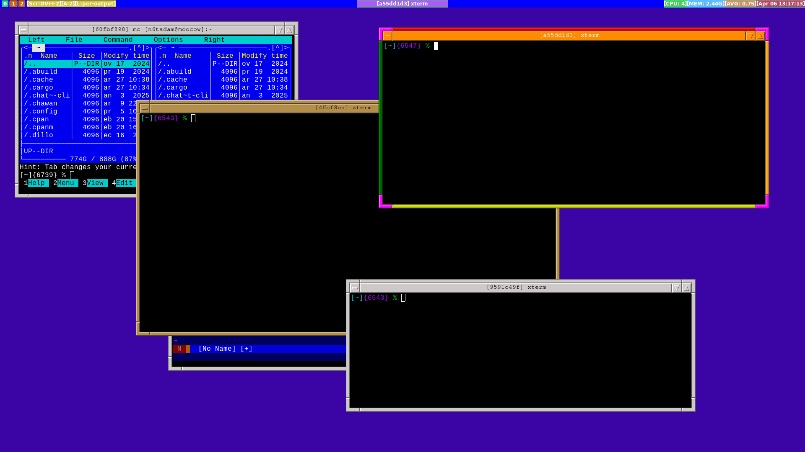
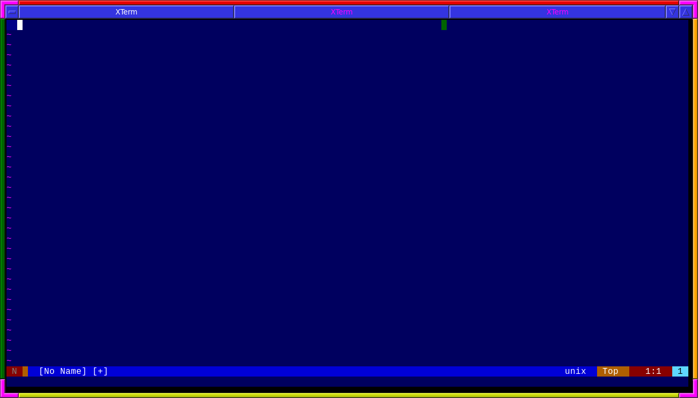
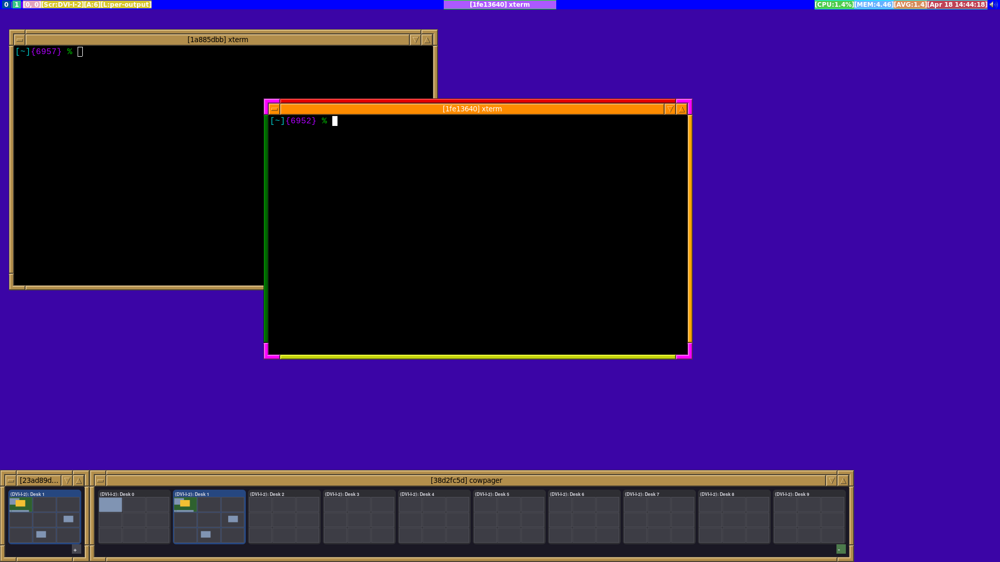

# CoW -- Compostitor on Wayland

<p align="center">
  
</p>

`cow` is a stacking window manager.  Unlike other compositors based on
wlroots, `cow` is a window manager using [river](https://codeberg.org/river/river)
as the compositor.

This allows for more focus on writing the window manager part without having
to worry too much about wayland protocol handling, etc., effectively lumping
that in with being a wayland display server.

## Inspiration

`cow`'s aims are to provide the following:

* The look-and-feel of `fvwm` and `mwm`.
* To provide a sensible mechanism for configuration, divorcing the need for
  complex configuration syntaxes, instead using dedicated commands that can be
  used both as a configuration file, and via IPC (runtime).

The commands are inspired by tmux(1).

## Where to Start?

There's been an attempt at some documentation:

* `cow(1)` -- documents the commands/config settings which can be used to
  configure `cow`.
* `moocow(1)` -- the CLI used to communicate with `cow` from shell-scripts,
  etc.
* `cowbar(1)` -- JSON structure of the state of `cow` -- primarily used to
  provide information to `waybar`, but can be used for any bar.

More concretely though, have a look at:

* [cow config file](./config/cow/cow.conf) -- this is documented and should help
  you start making changes.  Copy it to `~/.config/cow` to get started making
  changes,
* [waybar](./config/waybar/) -- this can be copied verbatim to `~/.config/` if
  desired to it can be configured to your liking.

## Wiki

See:  https://codeberg.org/thomasadam/cow/wiki/Home

## What does it look like?



There's also support for containers -- a top-level window which can group
windows together into tabs.



### Pages / Pager



A very crude video is [also available](https://youtu.be/tRdhfRfdPuI)

## How do I build CoW?

Because `cow` is a window manager reliant on `river`, then the binary for
`river` is required:

* [river](https://codeberg.org/river/river)

For the wayland parts:

* wayland_client
* xkbcommon
* pangocairo
* cairo
* libbsd (for non-BSD systems; linux, etc.)

Note that the names of the libraries above will vary across systems.

Documentation is written in [scdoc](https://git.sr.ht/~sircmpwn/scdoc):

* scdoc

For the embedded scripting language used by `script { ... }` blocks
(see *cow*(1), section SCRIPTING):

* bison (>= 3.0)
* flex  (>= 2.6)

The build system itself uses `meson`, and hence the following command will
configure, build, and install `cow`:

```
meson setup build
meson compile -C build && meson install -C build
```

## How do I run CoW?

There's a command called `cow-start` which you can run thus:

```
river -c 'cow-start'
```

It's recommended that you copy the [river init file](config/river/init) to
`~/.config/river` so that you can just run:

```
river
```

This will set up the environment before river starts to enable screen-sharing,
etc.  The [river init file](config/river/init) can be customised as needed.

Alternatively, a globally-installed `cow.desktop` file is installed allowing
cow to be used with wayland login managers.

## Contact and Support

You can email me at: thomas at xteddy dot org

Or, use the IRC channel on `libera.chat` -- `#cow-wayland`

IRC is preferred over other forms of communication.  Maybe I'll see you there?

-----

# FAQ

Here's some of the questions that have never been asked, frequently or
otherwise...

## Why is this called Cow?

Because originally, `cow` was going to be an all-in-one Compositor On Wayland
(CoW), but now that it uses river to do all the heavy-lifting, this nae is a
slight misnomer.

That said though, I like cows and, I'm going to stick with that name for now.

## Moocow?  Seriously?

Well, the way I see it, if you want `cow` to do anything, you need to "moo
(at) cow", so `moocow` as an external command seemed appropriate.

## Are multi-monitors supported?

Yes.  For now, one will need to edit [the start script](./tools/start.sh) to
run `wlr-randr` with the appropriate values.

Note that this is controlled via river(1) and `cow` has no means of being able
to set monitors directly.  To get a more visual overview of things, the
`wdisplays` command is helpful, and is similar to `arandr` from xrandr.

# Logo and mascot.

Meet our mascot, Anvil the cow.


Luis Sobalvarro kindly created the CoW logo for this project.


and...


Massive thanks to you, Luis!

These logos are released under the same licence as CoW itself -- that is to
say, they're free to use as long as attribution is given to Luis Sobalvarro.
