# CoW Window Decoration Gallery

These previews show an xterm window with each example decoration theme applied.
They were captured from CoW using `moocow`, `xterm`, and `grim` on a running Wayland session.

## afterstep

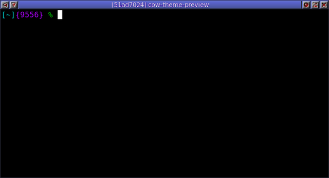

## awol

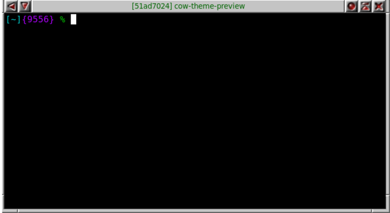

## blackbox

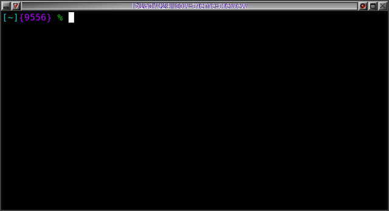

## brushedmetal

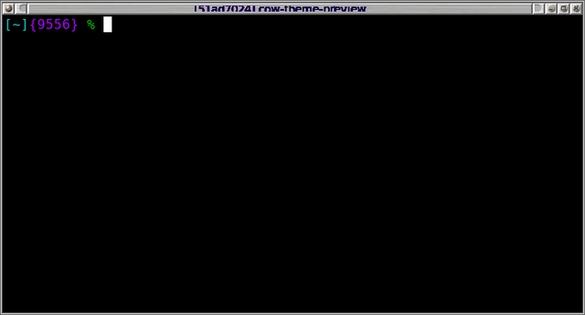

## cde

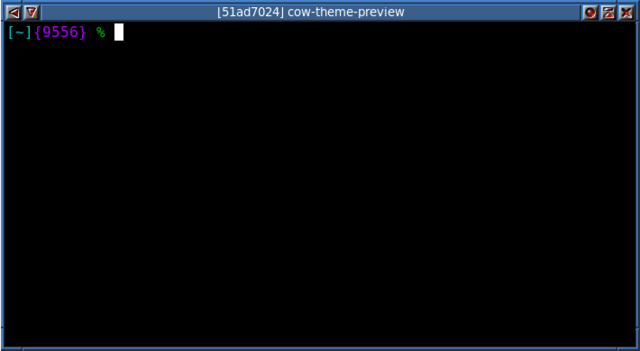

## celticbow

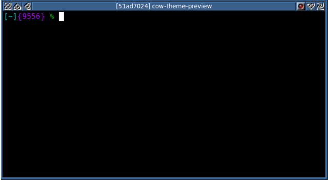

## default

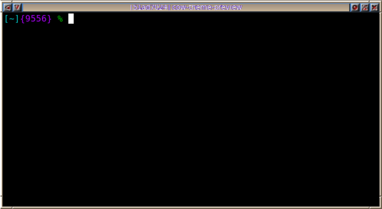

## e17

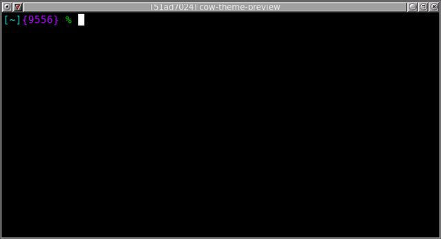

## ice

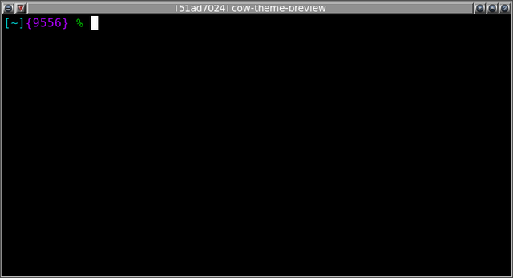

## luthien

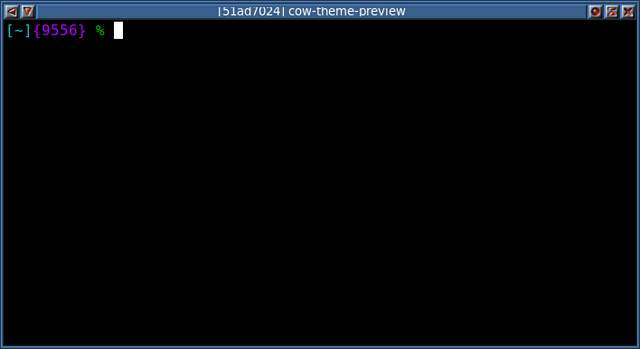

## mango

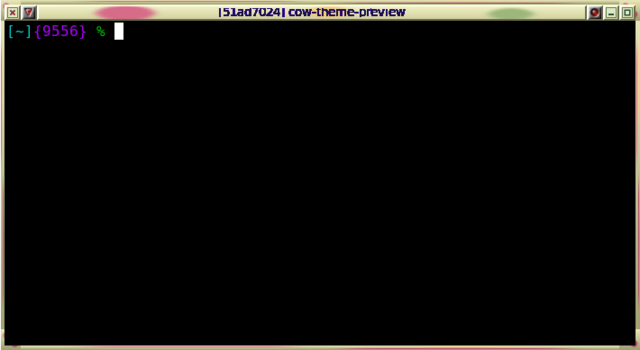

## mech

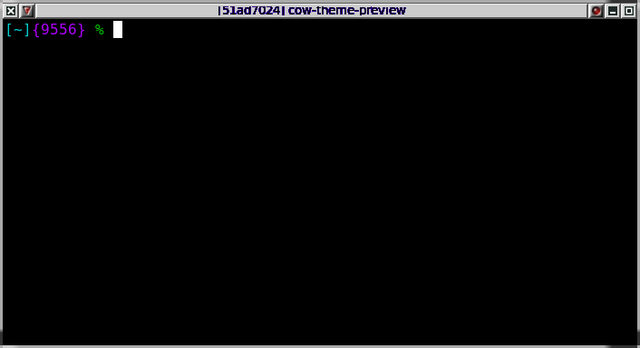

## metal

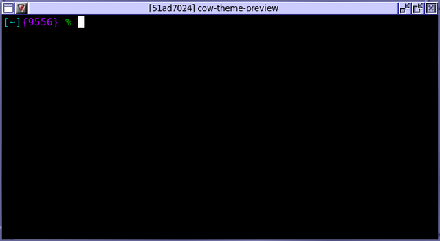

## migo

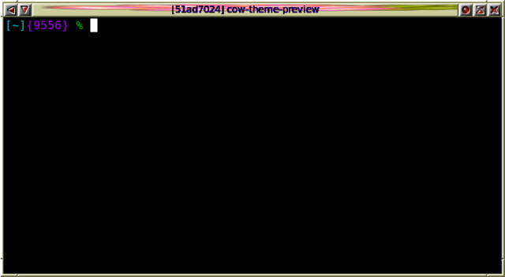

## minimal

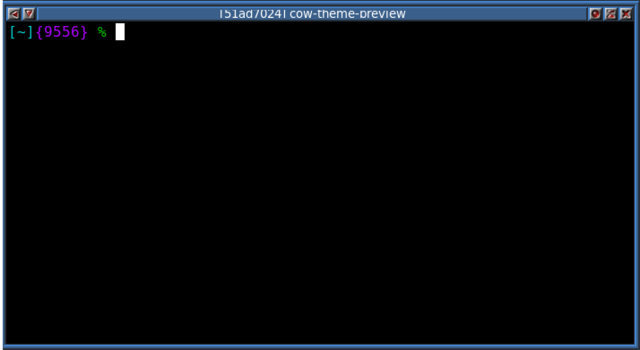

## nanogui

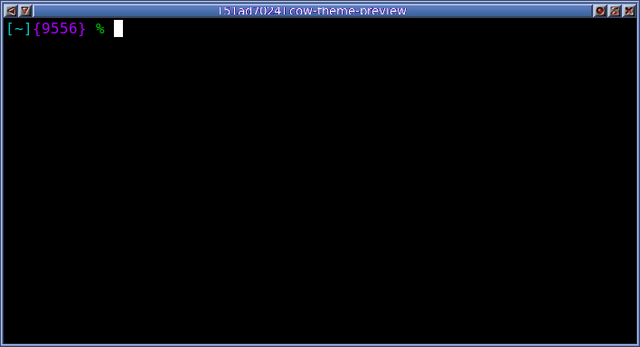

## olicha

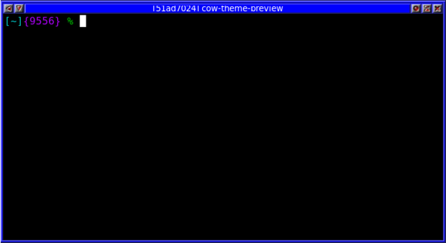

## osx

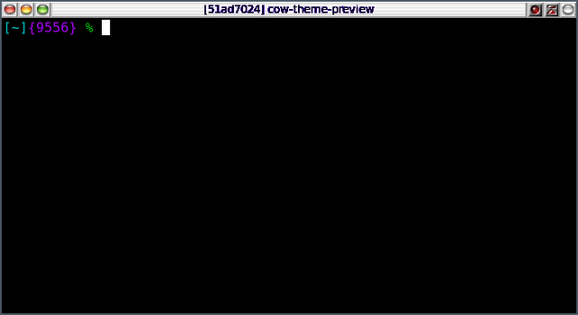

## plainbow

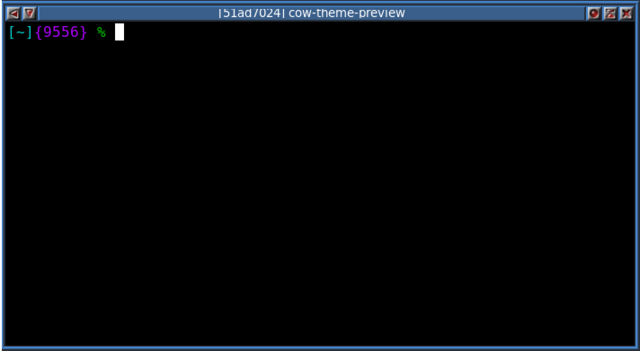

## qnx

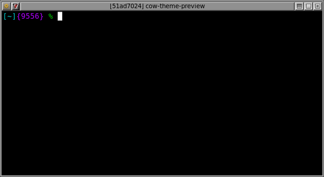

## redmond98

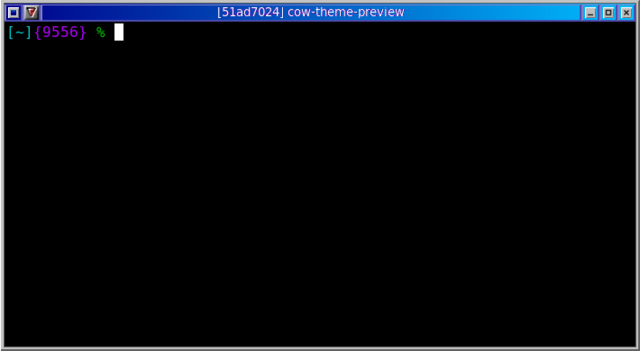

## redmondxp

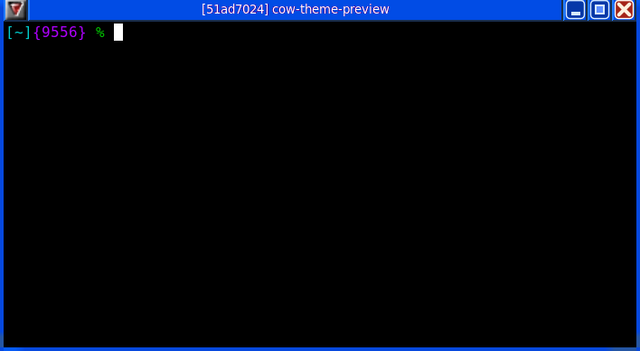

## sa

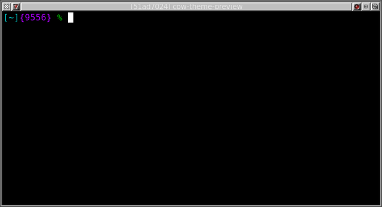

## skyred

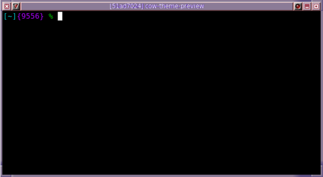

## spruce

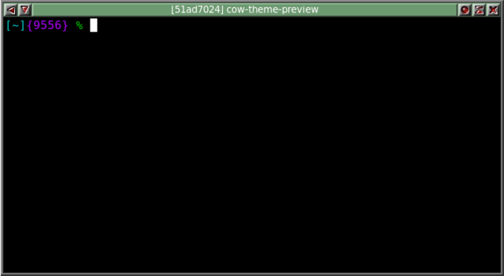

## steel

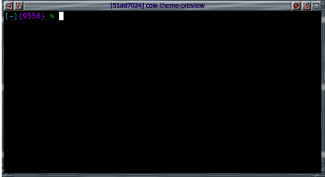

## transparent

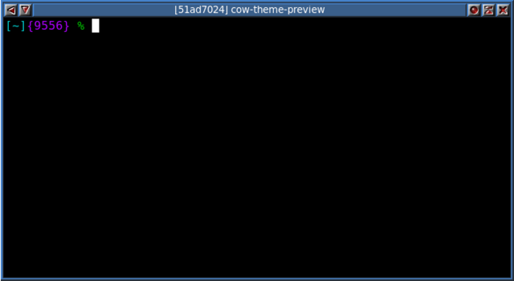

## unsafe

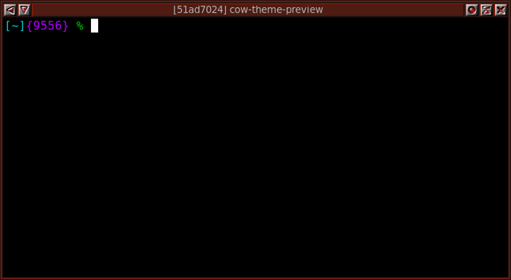
